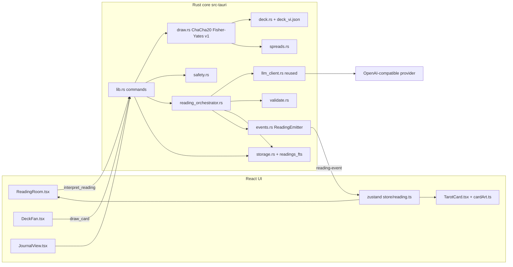

# Kế hoạch: TarotCouncil, ứng dụng desktop bốc bài và luận giải tarot dựa trên PlanCouncil

## 1. Overview
<!-- reviewers: all -->

**Mục tiêu.** TarotCouncil là desktop app để người dùng nhập câu hỏi, chọn kiểu trải và tự bốc lá từ bộ bài đã tráo. Sau đó một "hội đồng thầy bói" AI luận giải các lá theo câu hỏi. Giao diện là cảnh pixel-art giống phòng họp của PlanCouncil: bàn đọc bài có nến, nhân vật thầy bói, bong bóng thoại, hiệu ứng tráo và lật bài.

**Cách tiếp cận.** Fork PlanCouncil và giữ lại những phần đã được đối chiếu với code (research notes):
- Tauri v2, React 19, zustand, motion.
- `llm_client.rs` (retry, SSE, JSON tolerant).
- Cancel, `max_parallel_calls`, `cost.rs`, `budget.rs`.
- Ghi atomic, FTS5, keyring.
- `pixel.ts`, `PixelCharacter.tsx`.

Phần viết mới là domain tarot: bộ bài, kiểu trải, bộ bốc bài, luận giải 2 pha, cảnh đọc bài và cách vẽ lá.

**Luồng chính.**
1. Nhập câu hỏi.
2. Chọn kiểu trải và thầy bói.
3. Rust tráo bài, người dùng chọn lá.
4. Các thầy bói luận giải song song. Rust hậu kiểm và kiểm tra an toàn **toàn bộ** output trước khi công bố.
5. Trưởng thầy tổng hợp, kết quả lưu vào nhật ký.

**Giả định**
- Một người dùng, dữ liệu lưu cục bộ, provider là API kiểu OpenAI do người dùng tự cấu hình.
- Câu hỏi và các lá đã bốc **được gửi tới provider đó**. Người dùng được báo trước điều này (§3).
- Tiếng Việt là ngôn ngữ chính, tên lá có cả vi và en.
- Lá bài mặc định vẽ bằng pixel-art tự sinh. Ảnh RWS 1909 không đóng gói vì tình trạng bản quyền khác nhau giữa các nước (research notes).
- App chỉ mang tính giải trí. Dữ liệu và secrets tách hẳn khỏi PlanCouncil.

**Bất biến giữ từ PlanCouncil.** UI không chạm API key. Mọi lời gọi AI chạy trong Rust (ARCHITECTURE §1–2).

### Milestones
<!-- reviewers: pragmatic_reviewer -->

MVP gồm M0–M2. Mỗi milestone đều demo được.

| M | Nội dung | Demo |
|---|---|---|
| M0 | Chạy build/test nền trước khi sửa. Fork surgery (§2). Cách ly storage và keyring. `interpret_reading` để stub. CI xanh | App khởi động, cấu hình được provider |
| M1 | `deck.rs` (78 lá đạt nghiệm thu §4), `draw.rs` + golden test, trải 1 lá, 1 thầy bói, `safety.rs`, `SupportScreen`, hậu kiểm, thông báo quyền riêng tư, UI tối giản (lá dạng text) | Một lượt đọc chạy end-to-end |
| M2 | Trải 3 lá, 2–4 thầy bói, tổng hợp, `DeckFan`, `ReadingRoom`, Journal + FTS, khôi phục sau crash | Đọc 3 lá có hội đồng, mở lại được lượt cũ |
| M3 | Celtic Cross, 22 sprite Major, hiệu ứng tráo/lật hoàn chỉnh | Bản đầy đủ |

## 2. Architecture
<!-- reviewers: all -->

### Thành phần Rust (`src-tauri/src/`)
<!-- reviewers: pragmatic_reviewer, ml_engineer -->

| Module | Vai trò |
|---|---|
| `events.rs` | `ReadingEmitter` **mới**. Sink hiện tại nhận `EventEnvelope` của council nên không dùng nguyên trạng được. Module này giữ lại cơ chế throttle 50 ms / 4 KB của `orchestrator.rs:322-349`, dùng envelope tarot riêng, cấp `seq` dưới mutex theo từng lượt đọc và có unit test. |
| `deck.rs` | Nạp `assets/deck_vi.json` bằng `include_str!`. Validate lúc khởi động. |
| `spreads.rs` | Kiểu trải 1 lá, 3 lá (Quá khứ / Hiện tại / Tương lai), Celtic Cross (M3). |
| `draw.rs` | Seed 32 byte lấy từ `getrandom`, tạo `ChaCha20Rng`. Fisher-Yates tự viết trên `next_u32` với rejection sampling. Gắn `shuffle_algo_version = 1`. Có golden test seed → `deck_order` + `reversed_flags` chạy trong CI. |
| `safety.rs` | Lọc tự hại, y tế, tài chính, pháp lý trên văn bản đã chuẩn hoá (§5). |
| `validate.rs` | Hậu kiểm `ReaderOutput` và `Synthesis` (§3). |
| `reading_orchestrator.rs` | Chạy 2 pha. Dùng lại cancel token, `budget.rs`, `cost.rs`. |

Module sửa: `prompts.rs` (persona thầy bói, framing DATA), `roster.rs`, `lib.rs`, `storage.rs`.

### Fork surgery (M0)
<!-- reviewers: pragmatic_reviewer -->

Làm lần lượt theo thứ tự phụ thuộc. Mỗi bước là một PR và phải giữ CI xanh.
0. Xác minh cây mã đầy đủ. Chạy `cargo test` và build FE để lấy baseline.
1. Đổi root storage `plancouncil` thành `tarotcouncil`. Đổi keyring service thành `com.tarotcouncil.app`. Đổi `identifier` và `productName`.
2. Gỡ `mod` và command council khỏi `lib.rs`. Xoá `orchestrator.rs` **cùng lúc** với các module nó import: `context_builder`, `routing`, `staffing`, `sections`, `rerun`. Xoá `mcp.rs`. Kiểm tra `mod secrets;` (lib.rs:22). `interpret_reading` trả `Error{code:"not_implemented"}`.
3. Secrets còn 2 chế độ: keyring, và RAM khi `keyring_locked`. Giữ test cho nhánh `keyring_locked`, vì Linux không có secret service rất hay gặp lỗi này.
4. UI: xoá các tab council, `RerunDialog`, `ScopeBar`, `DiffView`, `PromptPanel`. Bỏ `diff` và `mermaid` khỏi dependencies.
5. Test cách ly với HOME tạm: không có ghi nào vào thư mục hoặc keyring service của PlanCouncil.

Thêm `UPSTREAM.md` ghi commit PlanCouncil gần nhất đã đồng bộ `llm_client.rs`.

### Thành phần UI (`src/`)
<!-- reviewers: ui_ux_designer, frontend_dev -->

| Thành phần | Vai trò |
|---|---|
| `ReadingRoom.tsx` | Cảnh 240×150 dựng trên khung `MeetingRoom.tsx`: bàn khăn tím, nến, 1–4 thầy bói, bong bóng thoại. Lá đặt theo `x, y, rotation` của từng vị trí. |
| `DeckFan.tsx` | Quạt lá úp. Nút "Tráo". Chọn lá bằng click, hoặc ←/→ (PageUp/PageDown nhảy 10 lá) + Enter. Có nút "Bốc tự động". Cần thử nghiệm với chuột và bàn phím ở M2. |
| `TarotCard.tsx` | Lật bằng `rotateY` khoảng 500 ms. Lá ngược xoay 180°. |
| `cardArt.ts` | Canvas 32×56. Minor vẽ procedural: số biểu tượng chất bài theo rank, lá triều đình thêm mũ hoặc vương miện. Major hiện khung, số La Mã và tên, sprite 16×16 vẽ tay ở M3. |
| `ReadingResult.tsx` | Panel văn bản riêng, tách khỏi cảnh. Đọc được bằng screen reader và điều khiển bằng bàn phím. |
| `ReadingTimeline.tsx`, `JournalView.tsx` | Thay `Timeline` và `HistoryView`. |
| `PrivacyNotice.tsx`, `SupportScreen.tsx` | Xem §3 và §5. |

## 3. Data Flow
<!-- reviewers: all -->

### Luồng một lần đọc bài

0. **Listener.** UI đăng ký listener `reading-event` một lần khi app khởi động, trước mọi command.

1. **`create_reading({question, spread_id, reader_ids})`**
   - Kiểm tra độ dài câu hỏi 3–500 ký tự và số thầy bói 1–4.
   - Chạy `safety.rs`. Trúng nhóm tự hại thì trả `{blocked:"self_harm"}` (§5).
   - Tạo UUID v4 và seed, chạy Fisher-Yates để có `deck_order[78]`.
   - Sinh `reversed_flags[78]`: rút 78 bit tiếp theo từ cùng RNG, theo thứ tự `deck_order`. Nếu `reversed_enabled = false` thì toàn bộ là false. Giá trị `reversed_enabled` được lưu vào reading.
   - Ghi atomic với `status = drawing`.

2. **`draw_card(reading_id, fan_index)`**
   - `fan_index` là chỉ số **cố định** trong `deck_order`, từ 0 đến 77. Lá đã bốc biến khỏi quạt nhưng chỉ số của các lá còn lại không đổi.
   - Lock theo lượt đọc. Từ chối nếu index trùng hoặc kiểu trải đã đủ lá.
   - Thêm vào `draws[]` một snapshot đầy đủ của lá, ghi atomic, rồi mới trả response.
   - Ghi lỗi thì trả `persist_failed` và UI không lật lá.

3. **`interpret_reading(reading_id)`**
   - Lần đầu dùng app (`privacy_ack = false`), UI hiện `PrivacyNotice` trước. Nội dung: câu hỏi và các lá sẽ gửi tới provider [tên endpoint]; lịch sử lưu cục bộ, không mã hoá. Người dùng chọn Đồng ý hoặc Huỷ.
   - Chỉ chạy khi `status ∈ {drawn, failed, cancelled}`. Nếu không thì trả `busy`. Mỗi lần chạy tăng `attempt_id`.
   - **Pha 1:** các thầy bói chạy song song. Output được **giữ trong Rust** cho đến khi mọi thầy bói xong hoặc lỗi. Trong lúc chờ, UI chỉ nhận `ReaderProgress`.
   - **Cổng an toàn:** nếu bất kỳ output nào có `crisis = true` thì huỷ các lời gọi còn lại, bỏ mọi output, đặt `status = support`, emit `SupportRequired`. Không phát `ReaderDone` nào.
   - **Commit pha 1:** ghi atomic `outputs` đã hợp lệ, **rồi mới** emit `ReaderDone` cho từng thầy bói.
   - **Pha 2:** trưởng thầy nhận các output hợp lệ. Kết quả qua cổng an toàn và hậu kiểm, ghi atomic, rồi emit `SynthesisDone`.
   - **Hoàn tất:** đặt `status = done`, cập nhật FTS, emit `ReadingDone`.
   - Ghi lỗi ở bất kỳ bước nào thì `status = failed` và emit `Error{code:"persist_failed"}`. Chưa ghi được thì không emit nội dung.

**JSON là nguồn sự thật, FTS là dữ liệu phụ.** FTS được cập nhật sau khi ghi JSON. FTS lỗi chỉ ghi log. Khi khởi động, nếu index thiếu hoặc lệch thì `rebuild_index` dựng lại từ các file. `delete_reading` xoá file JSON và dòng FTS tương ứng.

**Khôi phục sau crash.** Lúc khởi động, query `readings_fts` tìm các dòng `status = interpreting` (không quét toàn bộ file), đặt về `drawn` và bỏ output dở dang. `verify_reading` tái tạo `deck_order` và `reversed_flags` từ seed theo `shuffle_algo_version`, rồi kiểm xem `draws` có khớp `picks` không. Nếu lệch thì gắn nhãn "không kiểm chứng được" và không sửa dữ liệu.

### Hậu kiểm và chống bịa lá
<!-- reviewers: ml_engineer -->

**Kiểm tra bảo đảm** (chính xác, quyết định đạt hay trượt):
- Schema đúng.
- Số vị trí bằng số lá của kiểu trải.
- Từng cặp `position`/`card_id` khớp với `draws`.

**Tín hiệu bổ trợ** (không phải bảo đảm): dò tên lá nằm ngoài lượt bốc. Chỉ so mẫu "lá {name_vi}" và tên tiếng Anh, để tránh bắt nhầm cụm từ thường như "mặt trời" hay "công lý". Corpus `tests/validate_fp.jsonl` dùng để đo dương tính giả và âm tính giả.

**Xử lý khi trượt:** retry 1 lần kèm thông điệp sửa lỗi. Vẫn trượt thì emit `ReaderFailed`, UI hiện nghĩa gốc tĩnh của các lá. Không bao giờ hiển thị text thô.

Framing DATA cho câu hỏi chỉ giảm rủi ro prompt injection, không chặn được mọi chỉ dẫn độc hại. Cấu trúc output bị ràng buộc theo lá đã bốc nên phần bị injection chi phối được thu hẹp.

### Event contract `reading-event`
<!-- reviewers: frontend_dev, ml_engineer -->

**Envelope:** `{reading_id, attempt_id, seq, ts, payload}`, mirror sang `src/lib/contracts.ts`.
- `seq` tăng đơn điệu theo **từng lượt đọc**, xuyên suốt mọi attempt, không reset.
- `seq` được cấp dưới mutex trong `ReadingEmitter`. Event được emit theo đúng thứ tự cấp.

**Payload:**
- `ReaderStarted{reader_id}`
- `ReaderProgress{reader_id, chars}`
- `ReaderDone{reader_id, output}`
- `ReaderFailed{reader_id, reason}`
- `SynthesisStarted`
- `SynthesisDone{synthesis}`
- `SupportRequired`
- `Usage{tokens, cost_usd}`
- `ReadingDone`
- `Cancelled`
- `Error{code, message, retryable}`

**Đồng bộ ở client:**
1. Bỏ event khác `reading_id` đang mở.
2. Bỏ event có `attempt_id` nhỏ hơn attempt hiện tại.
3. Bỏ event có `seq` nhỏ hơn hoặc bằng `last_seq`.
4. Khi mở lượt đọc hoặc thấy hở seq: chuyển sang chế độ đệm event, gọi `get_reading` để nhận snapshot `{reading, attempt_id, last_seq}`. Snapshot được đọc dưới cùng mutex cấp seq. Thay toàn bộ state bằng snapshot, rồi áp các event đã đệm có `seq > last_seq`.

### Trạng thái UI
<!-- reviewers: frontend_dev, ui_ux_designer -->

Luồng chính: `idle → asking → shuffling → drawing(k/n) → interpreting → done`. Các nhánh phụ: `support`, `error`, `cancelled`.

- Trong `interpreting`, bong bóng hiện "đang suy ngẫm…". Lời giải xuất hiện đồng loạt sau khi qua cổng an toàn.
- Nút Dừng gọi `cancel_reading`, các lá đã bốc vẫn được giữ.
- Lượt cũ mở ra với các lá đã lật sẵn.
- `prefers-reduced-motion` hoặc tuỳ chọn "Tắt hiệu ứng" bỏ animation tráo và lật.

## 4. Tech Stack & Schema
<!-- reviewers: all -->

**Thêm vào Rust:** `rand_chacha 0.3`, `rand_core 0.6`, `getrandom 0.2` (cùng dòng `rand_core 0.6`).

**Giữ nguyên:** `tauri-plugin-log` và `log` (đã có ở Cargo.toml:19-20), UUID v4, các lệnh `build:mac/win/linux`. Frontend không thêm dependency.

**Log:** ghi `reading_id`, `attempt_id`, `reader_id`, latency, token và mã lỗi provider. Không log câu hỏi, không log key. Settings có nút "Mở thư mục log".

### Dữ liệu bộ bài và kiểu trải
<!-- reviewers: ml_engineer, frontend_dev -->

**`Card`** (78 bản ghi):
- `id`, `arcana`, `suit|null`, `rank` (0–21, hoặc 1–14 với Page=11 … King=14).
- `name_vi`, `name_en`.
- `keywords_upright[]`, `keywords_reversed[]`.
- `meaning_upright`, `meaning_reversed`: tiếng Việt, 60–100 từ, đội tự viết.
- `element`, `art_key`.

**Nghiệm thu bộ bài (M1):**
- Test tự động: đủ 78 lá, id duy nhất, không trường nào rỗng, độ dài nghĩa đúng 60–100 từ.
- Một người review nội dung theo checklist: nghĩa nhất quán, không chép sách có bản quyền.

**`Spread`:** `id`, `name_vi`, `positions[{index, label_vi, meaning_hint, x, y, rotation}]`.

### Persona thầy bói
<!-- reviewers: ml_engineer, ui_ux_designer -->

`ReaderPersona{id, name, style_prompt, model_endpoint, appearance_seed}`. Bốn persona mặc định:
- **Bà Đồng Cổ Điển:** theo nghĩa RWS truyền thống.
- **Nhà Tâm Lý Jung:** biểu tượng và archetype.
- **Người Thực Tế:** đưa ra hành động cụ thể.
- **Kẻ Hoài Nghi:** nêu cách hiểu khác.

Trưởng thầy là persona riêng dùng cho tổng hợp.

### Kết quả của mô hình
<!-- reviewers: ml_engineer, frontend_dev -->

- `ReaderOutput{positions[{position, card_id, interpretation}], overall, tone: hopeful|cautionary|neutral, crisis: bool}`
- `Synthesis{summary, agreements[], divergences[], advice[], disclaimer, crisis: bool}`

**Ước lượng (cần đo theo provider, không phải cam kết):**
- Trải 3 lá: khoảng 1,5k input + 600 output mỗi thầy bói.
- Celtic Cross với 3 thầy bói và tổng hợp: khoảng 15k token.
- Mục tiêu thời gian: 1 thầy bói trải 3 lá dưới 25 s, cả lượt dưới 45 s. Lượt đọc chờ thầy bói chậm nhất. `draw_card` dưới 100 ms.

**Ngân sách.** Ước lượng trước khi chạy dùng bảng tĩnh theo kiểu trải × số thầy bói × đơn giá. `budget.rs` là **giới hạn token mềm**, không phải trần USD. Chi phí thực tế có thể vượt ước lượng khi chạy song song hoặc retry. UI hiển thị `Usage` thực tế.

### Lưu trữ
<!-- reviewers: pragmatic_reviewer, frontend_dev -->

File `{app_data}/tarotcouncil/readings/{id}.json` lưu `Reading` gồm:
- Định danh và phiên bản: `schema_version`, `id`, `created_at`, `app_version`, `deck_version`.
- Câu hỏi: `question`, `spread_id`, `reader_ids`.
- Tráo và bốc: `seed_hex`, `shuffle_algo_version`, `reversed_enabled`, `deck_order[]`, `reversed_flags[]`, `picks[]`, `draws[{position, position_label_vi, fan_index, card_id, name_vi, name_en, reversed}]`.
- Luận giải: `attempt_id`, `outputs`, `synthesis`, `usage`.
- `status`: `drawing | drawn | interpreting | done | failed | cancelled | support`.

Loader đọc tolerant bằng `serde(default)`. File hỏng thì bỏ qua và ghi log. `get_reading` lược bỏ `seed_hex`, `deck_order` và `reversed_flags` trước khi trả cho UI.

**FTS:** bảng `readings_fts(question, summary, card_names, status UNINDEXED, created_at UNINDEXED)`.

**`config.json`** thêm: `reversed_enabled`, `default_spread`, `default_readers`, `animations`, `privacy_ack`.

### IPC commands mới
<!-- reviewers: frontend_dev -->

- `list_spreads`, `get_deck`
- `create_reading`, `draw_card`, `auto_draw`
- `interpret_reading`, `cancel_reading`
- `list_readings`, `get_reading`, `delete_reading`, `search_readings`, `verify_reading`

Giữ nguyên các command provider, config, keyring và cost.

## 5. Edge Cases & Trade-offs
<!-- reviewers: all -->

### An toàn nội dung
<!-- reviewers: ml_engineer, ui_ux_designer -->

**Giới hạn.** Cả bộ lọc từ khoá lẫn cờ `crisis` đều **có thể bỏ sót**, nên không được coi là phát hiện đầy đủ. Vì vậy mọi màn hình đều có liên kết "Cần hỗ trợ?" để người dùng tự mở `SupportScreen` bất cứ lúc nào.

**Lớp 1: `safety.rs`, chạy trước khi bốc bài.**
- Chuẩn hoá văn bản: lowercase, bỏ dấu, gộp khoảng trắng.
- So với danh sách cụm từ vi/en, bao gồm biến thể có dấu, không dấu và tiếng lóng phổ biến.
- Kiểm thử bằng corpus `tests/safety_vi.jsonl` gồm mẫu dương và mẫu âm.
- Khi trúng: mở `SupportScreen` với nút "Quay lại sửa câu hỏi". Bắt nhầm chỉ tốn công diễn đạt lại, và không có nút "vẫn đọc với câu này".

**Lớp 2: cờ `crisis` từ mô hình.** Áp dụng cổng an toàn ở §3. Kết quả là `status = support`, không lưu và không hiển thị output nào.

**`SupportScreen`** gồm:
- Lời lẽ ân cần.
- Gợi ý liên hệ người đáng tin cậy.
- Ưu tiên nhất là hướng dẫn gọi dịch vụ khẩn cấp địa phương khi có nguy hiểm trước mắt.
- Số đường dây cụ thể chỉ hiển thị khi có trong `assets/support.json` với `verified_at`. Mục quá 12 tháng chưa xác minh lại sẽ bị ẩn. Không mặc định theo quốc gia.

**Y tế, tài chính, pháp lý:** vẫn đọc bài, nhưng prompt cấm chẩn đoán và khuyên đầu tư, và kết quả có disclaimer bắt buộc.

Mọi persona được dặn: ứng dụng chỉ mang tính giải trí, không tiên đoán cái chết, không đưa ra kết luận nguy hiểm.

### Lỗi và các trường hợp biên
<!-- reviewers: frontend_dev, pragmatic_reviewer -->

| Trường hợp | Xử lý |
|---|---|
| Provider lỗi hoặc offline | Retry theo `llm_client.rs`. Nếu chỉ một thầy bói lỗi: `ReaderFailed`, các thầy còn lại chạy tiếp. Nếu tất cả lỗi: `status = failed`, UI hiện nghĩa gốc tĩnh kèm nút "Luận giải lại". |
| Event đến trễ sau khi huỷ hoặc chạy lại | Bộ lọc `attempt_id` và `seq` loại bỏ. |
| Click đúp khi bốc lá | Lock theo lượt đọc và kiểm tra `picks` trùng. |
| Đổi nghĩa hoặc bản dịch lá ở bản sau | `draws` và `outputs` đã chứa snapshot tên lá, phân biệt bằng `deck_version`. |
| Keyring bị khoá | Giữ key trong RAM cho phiên hiện tại và hiện banner. |
| Truy cập | `aria-label` gồm tên, chiều và vị trí. Quạt bài điều khiển hoàn toàn bằng bàn phím. Panel `ReadingResult` đọc được tuần tự. |

### Trade-offs
<!-- reviewers: pragmatic_reviewer -->

- **Fork thay vì shared crate:** ra MVP nhanh. Cái giá là phải cherry-pick thủ công, theo dõi qua `UPSTREAM.md`.
- **Giữ output đến khi tất cả thầy bói xong:** chờ lâu hơn (bằng thầy chậm nhất), nhưng không bao giờ công bố nội dung trước cổng an toàn. Hiệu ứng "đang suy ngẫm" lấp khoảng chờ.
- **Không stream lời giải:** cùng lý do như trên.
- **Lưu `deck_order` và `reversed_flags`:** tốn thêm khoảng 2 KB mỗi file, đổi lại resume không phụ thuộc phiên bản crate.
- **Luận giải 2 pha thay vì vòng hội tụ:** rẻ hơn khoảng 3 lần token. Các điểm khác biệt giữa thầy bói là nội dung có giá trị.
- **Lọc từ khoá + cờ mô hình, không dùng classifier riêng:** rẻ, nhưng có thể bỏ sót. Bù lại bằng lối vào hỗ trợ luôn hiển thị.

### Out of scope
<!-- reviewers: all -->

- Hỏi tiếp hoặc chat nhiều lượt.
- Kiểu trải và bộ bài tự tạo (Thoth, Lenormand).
- Đóng gói hoặc import ảnh RWS (`import_card_art`).
- Mã hoá dữ liệu cục bộ.
- Nhập cấu hình từ PlanCouncil.
- Đồng bộ đám mây, tài khoản, chia sẻ, bản mobile.
- Âm thanh.
- Thống kê lá, "lá của ngày", thông báo.
- Classifier an toàn riêng.
- Shared crate `llm_core`.
- Dashboard chi phí.
- Metrics hoặc telemetry ngoài file log.
- Chế độ MCP.
- Streaming từng token.
- Chọn lá theo nhóm hoặc thanh trượt: chỉ cân nhắc nếu thử nghiệm ở M2 cho thấy quạt bài khó dùng.

## 6. Changelog (v2 → v3)
<!-- reviewers: all -->

| # | Reviewer | Issue | Resolution | Status |
|---|---|---|---|---|
| 1 | ui_ux_designer, ml_engineer | `ReaderDone` công bố trước khi xong kiểm tra crisis | Giữ mọi output trong Rust đến khi tất cả thầy bói xong. Có cổng an toàn, `status = support` và `SupportRequired`, tách biệt với `cancelled` | Fixed |
| 2 | ui_ux_designer | Thứ tự lưu và emit, FTS | Ghi atomic trước rồi mới emit. Lỗi ghi thì `persist_failed`. JSON là nguồn sự thật, FTS cập nhật sau và có `rebuild_index` | Fixed |
| 3 | ui_ux_designer, frontend_dev, ml_engineer | Phạm vi `seq`, snapshot, listener | `seq` theo lượt đọc, cấp dưới mutex. Snapshot kèm `attempt_id`/`last_seq`. Client đệm event trong lúc đồng bộ. Listener đăng ký lúc khởi động. Thêm `ts` vào envelope | Fixed |
| 4 | frontend_dev, ml_engineer, ui_ux_designer | Lọc từ khoá và crisis không đủ, bắt nhầm | Ghi rõ giới hạn. Chuẩn hoá văn bản và có corpus test vi. Liên kết "Cần hỗ trợ?" luôn hiển thị. Bắt nhầm chỉ phải sửa câu hỏi | Partially fixed |
| 5 | frontend_dev, ui_ux_designer | Quyền riêng tư trước khi gọi AI, xoá FTS | Thêm `PrivacyNotice` và `privacy_ack`. `delete_reading` xoá cả dòng FTS. Mã hoá cục bộ đưa vào Out of scope | Fixed |
| 6 | ml_engineer, frontend_dev, ui_ux_designer | So tên lá và framing DATA bị coi là bảo đảm | Tách kiểm tra bảo đảm (schema, position/card_id) với tín hiệu bổ trợ. Dò theo mẫu "lá X" và có corpus đo FP/FN | Fixed |
| 7 | ui_ux_designer, ml_engineer, frontend_dev | Số hỗ trợ VN mặc định | Ưu tiên dịch vụ khẩn cấp địa phương. Số cụ thể chỉ hiện khi có `verified_at`, quá hạn thì ẩn | Fixed |
| 8 | frontend_dev, ml_engineer, ui_ux_designer | `fan_index`, chiều ngược, snapshot lá | `fan_index` cố định trong `deck_order`. `reversed_flags` sinh sau shuffle từ cùng RNG. Lưu `reversed_enabled`. `draws` chứa tên và nhãn vị trí. `verify_reading` kiểm cả picks và chiều | Fixed |
| 9 | ui_ux_designer | Tách EventSink không tạo được contract tarot | `ReadingEmitter` mới, có test, chỉ giữ cơ chế throttle | Fixed |
| 10 | ui_ux_designer, ml_engineer | `budget.rs` và ước lượng bị coi là cam kết | Ghi rõ là giới hạn token mềm. Số liệu là mục tiêu cần đo | Fixed |
| 11 | all | Thu hẹp MVP | MVP gồm M0–M2 (trải 1 và 3 lá). Celtic Cross và sprite Major chuyển sang M3. Import RWS đưa vào Out of scope. Thêm nghiệm thu bộ bài | Fixed |
| 12 | frontend_dev | Xác minh build nền | Thêm bước 0 trong fork surgery | Fixed |
| 13 | pragmatic_reviewer | Thứ tự xoá làm CI đỏ | Xoá `orchestrator.rs` cùng các module phụ thuộc ở M0, `interpret_reading` để stub | Fixed |
| 14 | pragmatic_reviewer | `tauri-plugin-log` đã có, thiếu version crate | Đổi thành "giữ". Ghi rõ `rand_chacha 0.3` / `rand_core 0.6` / `getrandom 0.2` | Fixed |
| 15 | pragmatic_reviewer | Safety gate nên có từ M1 | Chuyển `safety.rs` và `SupportScreen` lên M1 | Fixed |
| 16 | pragmatic_reviewer | Test `keyring_locked`, khôi phục khi khởi động, cherry-pick, golden test | Giữ test RAM fallback. Khôi phục bằng query cột `status` trong FTS. Thêm `UPSTREAM.md`. Thêm golden test trong CI | Fixed |
| 17 | frontend_dev | Quạt 78 lá khó chọn | Thêm PageUp/PageDown, thử nghiệm ở M2. Chọn theo nhóm đưa vào Out of scope | Partially fixed |